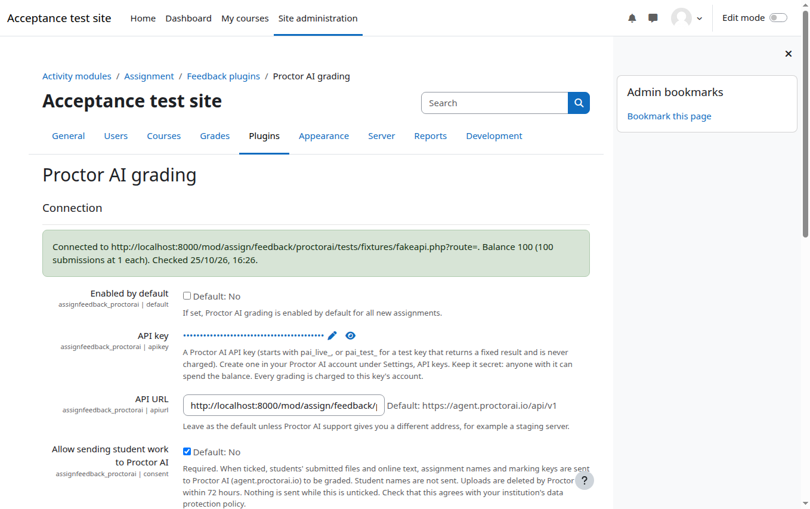
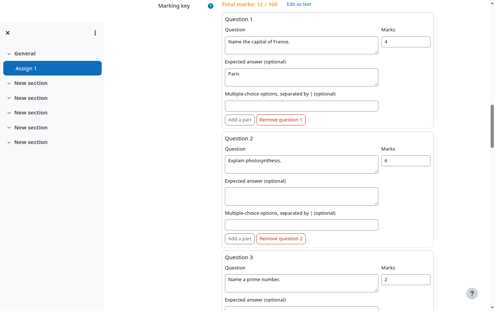
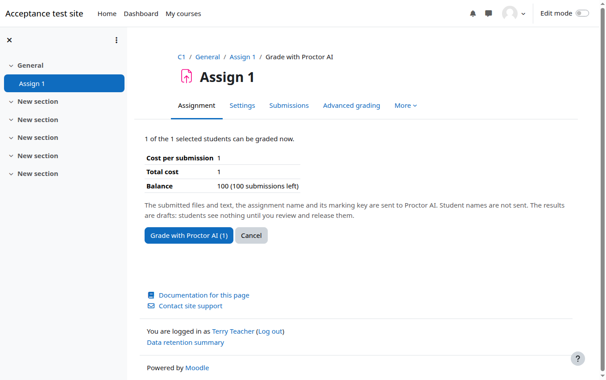
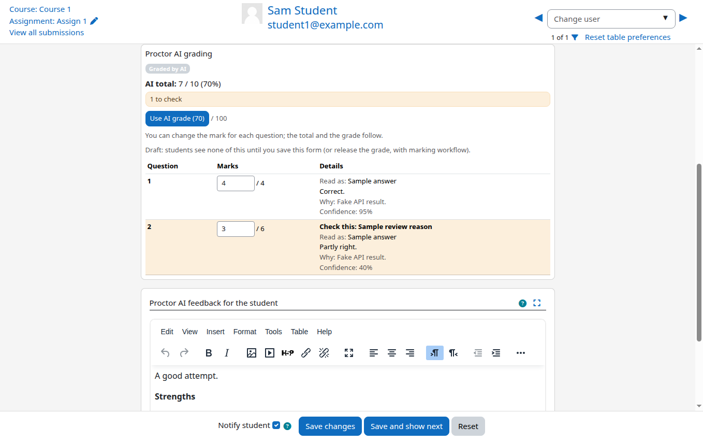
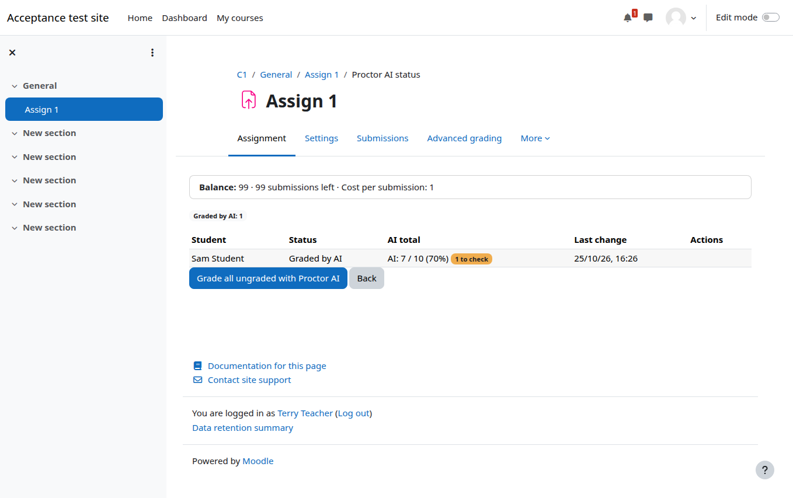
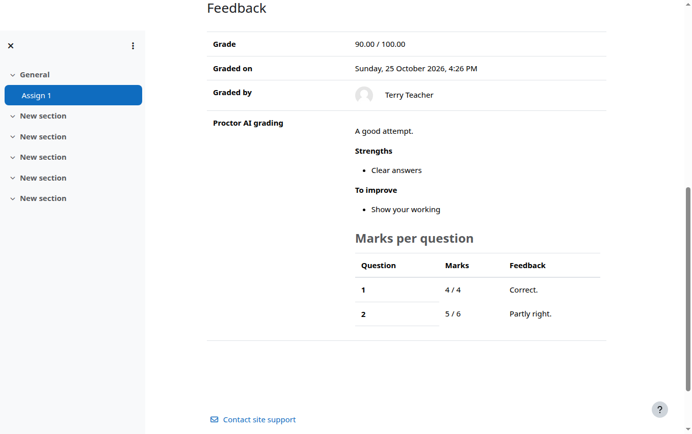

# Proctor AI grading for Moodle: guides

Proctor AI reads students' handwritten answers (photos or PDFs) and typed answers, and marks them against a marking key the teacher writes. In Moodle it works inside a normal **Assignment**. The AI only prepares a draft. The teacher checks it and decides what students see.

Pick the guide for your role:

| Guide | Who it is for | What it covers |
|---|---|---|
| [Getting started for administrators](admin-guide.md) | Moodle site administrators | Installing the plugin, connecting your Proctor AI account, the settings, costs and alerts |
| [Teacher guide](teacher-guide.md) | Teachers | Turning it on in an assignment, writing the marking key, grading, checking and releasing marks |
| [What students see](student-guide.md) | Students, and teachers who want to explain it | How to submit good photos, and when marks appear |
| [What if…? Questions and unusual cases](faq.md) | Everyone | Blurry photos, resubmissions, running out of balance, groups, rubrics and more |
| [Privacy and data](privacy.md) | Administrators, data protection officers | What is sent, what is not, how long it is kept |

## The whole journey on one page

1. **The administrator connects Moodle to Proctor AI once.** They paste an API key from their Proctor AI account and tick the consent box. Nothing is ever sent before that box is ticked.
2. **The teacher turns on "Proctor AI grading" in an assignment** and writes the marking key: the questions, the marks for each, and (optionally) the expected answers.
3. **Students submit as usual:** photos of their written work, a PDF scan, or typed online text.
4. **The teacher sends the submissions to Proctor AI.** A page shows the cost and the balance first. Grading can also start by itself when students submit.
5. **Proctor AI marks each question** and says what it read, why it gave the mark, and how sure it is. Answers it is unsure about are highlighted with **Check this**.
6. **The teacher reviews** each student in the usual Moodle grader, changes any mark, and edits the feedback.
7. **The teacher releases the grades.** Only now do students see their marks and feedback.

Students never see anything the teacher has not approved. Grades that a teacher has already given are never changed by the AI.

## Screenshots

| | |
|---|---|
|  |  |
| The administrator's settings page shows whether Moodle is connected and how many submissions the balance covers. | Teachers write the marking key question by question. |
|  |  |
| Before anything is sent, the teacher sees how many submissions will be graded and what it costs. | The AI result appears in the grader, with the questions to check highlighted. |
|  |  |
| The status page lists every student's grading, with Retry and Cancel. | After release, students see their marks per question and the feedback. |

## Help

- Problems with the plugin: [open an issue on GitHub](https://github.com/UpendraAkki/moodle-assignfeedback_proctorai/issues).
- Your Proctor AI account, balance or API keys: sign in at [agent.proctorai.io](https://agent.proctorai.io) and go to **Settings**.
